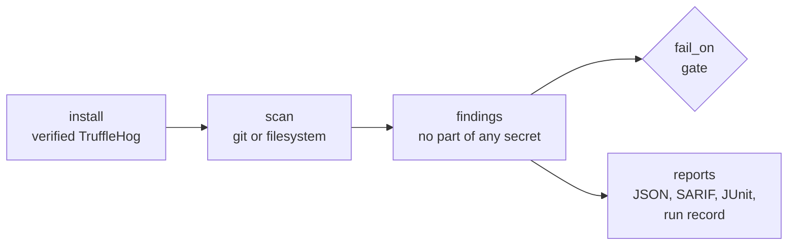

<div align="center">


# TruffleHog for CircleCI and GitHub Actions

### Find leaked secrets in your commits and files with a checksum-verified TruffleHog, without sending them anywhere.

Install a checksum-verified [TruffleHog](https://github.com/trufflesecurity/trufflehog) and scan the commits a branch adds, a repository's whole history, or a directory for API keys, tokens, private keys and other credentials, as orb commands or GitHub Actions.<br>
Secrets never written to a log or report · Verification off unless you turn it on · No self-update<br>
A gate that tells findings from failures · SARIF for code scanning · JUnit for test tabs · No `sudo`

[](https://circleci.com/gh/juburr/trufflehog-orb)
[](https://github.com/juburr/trufflehog-orb/actions/workflows/actions.yml)
[](https://circleci.com/developer/orbs/orb/juburr/trufflehog-orb)
[](LICENSE)
[](https://discuss.circleci.com/c/ecosystem/orbs)


**[Quick Start](#-quick-start)** · **[Features](#-why-trufflehog-orb)** · **[Recipes](#-recipes)** · **[Commands](#-commands)** · **[GitHub Actions](#-github-actions)** · **[Security](#-secure-by-design)** · **[Network Access](#-network-access)**

<sub>An unofficial, community-maintained CircleCI orb and set of GitHub Actions, not affiliated with Truffle Security. [Contributions are welcome!](#-contributing)</sub>

</div>

<br>

## ✨ Why trufflehog-orb?

<table>
<tr>
<td width="33%" valign="top">
🙈 <b>Reports that leak nothing</b><br><br>
TruffleHog's own output holds every secret it finds, in full. The orb keeps it in a private directory that is deleted when the step ends, and writes reports that say where each secret is, what kind it is and whether it works, but hold no part of it, not even a prefix. Every report is checked for every secret before the step ends.
</td>
<td width="33%" valign="top">
🔕 <b>Verification only when you ask</b><br><br>
TruffleHog can check whether a secret works by trying it against the service it belongs to. That sends the secret out of the job, so it is off by default. Turn it on with <code>verify: true</code>, and fail only on secrets that work with <code>fail_on: verified</code>.
</td>
<td width="33%" valign="top">
🌿 <b>The commits a branch adds</b><br><br>
By default <code>scan</code> reads the commits since the branch left its base: the pull request's base on GitHub Actions, the remote's default branch elsewhere, or <code>base_ref</code>. A secret committed and then deleted is still caught; one already in history doesn't fail every build after it.
</td>
</tr>
<tr>
<td width="33%" valign="top">
📦 <b>A verified TruffleHog that stays put</b><br><br>
<code>install</code> checks TruffleHog against this orb's SHA-512 table before it runs. Every scan passes <code>--no-update</code>: otherwise TruffleHog asks its update server for a newer release and replaces itself with it, unsigned, before scanning.
</td>
<td width="33%" valign="top">
🚦 <b>A gate you can trust</b><br><br>
Secrets fail the step, and <code>report_only</code> reports them instead. A scan that can't complete, that logs a scan error and exits 0 (as TruffleHog does for a ref it can't resolve), or that scanned nothing fails either way, instead of passing on nothing.
</td>
<td width="33%" valign="top">
🗂️ <b>Reports where you look</b><br><br>
JSON with every finding, SARIF for GitHub code scanning, and JUnit for CircleCI's Tests tab, plus an optional run record of exactly what was scanned with which TruffleHog.
</td>
</tr>
</table>

### 🧩 The Orb vs. a Hand-Rolled Script

| | Hand-rolled | trufflehog-orb |
|---|---|---|
| Installing TruffleHog | `curl \| sh` of its install script, or the official action's unpinned `latest` image | SHA-512 verified, cached, mirrored if you like |
| Updates | TruffleHog replaces itself with an unsigned download unless you pass `--no-update` | never |
| The secrets it finds | printed in full to the log, which anyone who can read the job can see | never printed or written; reports say where they are |
| Verification | on: every secret found is sent to its service | off unless `verify: true` |
| `--since-commit main` in a CI checkout | fails to resolve in TruffleHog's own clone, scans nothing, exits 0 | SHAs, and a scan error fails the step |
| A scan that scanned nothing | passes | fails |
| Pre-commit variables (`HUSKY`, `PRE_COMMIT`) in the job | turn the scan into a scan of staged changes only | ignored |
| CircleCI's blobless `checkout` | TruffleHog can't clone it, and the scan fails | the objects it lacks are fetched first |

## 🔄 How It Works



1. **`install`** puts a verified TruffleHog on the `PATH`.
2. **`scan`** works out which commits or files to read, runs TruffleHog with `--json --no-update`, keeps its raw output in a private directory, and writes reports built from where each secret is, never from the secret.
3. The gate fails the step on secrets at or above `fail_on`, unless `report_only` is true.

## 🚀 Quick Start

### CircleCI

```yaml
version: 2.1

orbs:
  trufflehog: juburr/trufflehog-orb@0.1.0

jobs:
  secrets:
    docker:
      - image: cimg/base:current
    steps:
      - checkout
      - trufflehog/install
      - trufflehog/scan

workflows:
  secrets:
    jobs:
      - secrets
```

The scan reads the commits the branch adds to `origin/main` (or whatever `origin/HEAD` names), fails on any secret found, and stores the reports in the job's artifacts under `trufflehog-reports/` and the findings in its Tests tab. On the default branch itself there is nothing to compare with; to scan what each push adds there too, pass `base_ref: << pipeline.git.base_revision >>`.

CircleCI's `checkout` makes a blobless clone by default, which lacks the files of older commits. TruffleHog clones the checkout before scanning it, and git can't clone a repository that lacks objects, so the scan first fetches what the checkout lacks from its remote, in one request. That downloads about what a full checkout would; `checkout: method: full` makes one in the first place.

### GitHub Actions

```yaml
jobs:
  secrets:
    runs-on: ubuntu-24.04
    permissions:
      contents: read
      security-events: write
    steps:
      - uses: actions/checkout@v7
        with:
          fetch-depth: 0
          persist-credentials: false
      - uses: juburr/trufflehog-orb/actions/install@v0.1.0
      - uses: juburr/trufflehog-orb/actions/scan@v0.1.0
      - uses: github/codeql-action/upload-sarif@v4
        if: always()
        with:
          sarif_file: /tmp/trufflehog-reports/trufflehog.sarif
```

On a pull request the scan reads the pull request's commits; on a push, the commits the push added; in a merge queue, the group's. `fetch-depth: 0` gives it the history to compare with.

## 🍳 Recipes

### Scan What Each Push Adds, on Every Branch

On CircleCI, `pipeline.git.base_revision` is the commit a branch was at before the push, so every push's commits are scanned, the default branch's included. When it is empty, as it can be for a new branch, the scan compares with `origin/HEAD`. After a force-push the old commit may not be in the checkout, which fails the step with a message saying so.

```yaml
- trufflehog/scan:
    base_ref: << pipeline.git.base_revision >>
```

### Audit a Repository's Whole History

`scope: history` reads every commit HEAD's history holds, and `scope: all` every ref in the checkout, other branches and tags included. A secret in history stays there until it is rotated and the history rewritten, so an audit usually reports without failing:

```yaml
- trufflehog/scan:
    scope: history
    report_only: true
    report_name: history
```

### Fail Only on Secrets That Work

With verification on, TruffleHog tries each secret against its service, and `fail_on` can ignore the ones the service rejects:

```yaml
- trufflehog/scan:
    verify: true
    fail_on: unknown   # secrets that work, or whose check couldn't decide
```

`fail_on: verified` fails only on secrets that work. Remember what verification costs: each secret found leaves the job.

### Scan Files, Such as a Build's Output

`source: filesystem` reads the files under `paths` as they are now, leaving out `.git` directories:

```yaml
- trufflehog/scan:
    source: filesystem
    paths: dist, build
    report_name: build
```

### Leave Out Test Fixtures and Accepted Findings

- **A file of path patterns.** `exclude_paths` names a file of regular expressions, one per line, for paths not to scan; `include_paths` one for the paths to scan alone.
- **A comment.** A line whose secret is followed by `trufflehog:ignore` on the same line isn't reported. `no_ignore_tag: true` reports those too.
- **Detectors.** `exclude_detectors: slack` turns a detector off; `include_detectors: github, aws` runs only those.

```yaml
- trufflehog/scan:
    exclude_paths: .trufflehog-exclude
    exclude_detectors: slack
```

### Your Own Detectors

A TruffleHog configuration file with custom regular-expression detectors goes in `config`. Their findings are named `CustomRegex`.

### Keep a Run Record

`run_record: true` writes `<report_name>.run-record.json`: the TruffleHog that ran (path, version, SHA-512), its arguments, the commits or paths scanned, TruffleHog's own summary, the counts, the gate and the CI job, as [`schemas/run-record.v1.json`](schemas/run-record.v1.json) describes. It holds no part of any secret.

## 🧰 Commands

| Command | What it does |
|---|---|
| [`install`](#trufflehoginstall) | Installs TruffleHog, verified against this orb's checksum table |
| [`scan`](#trufflehogscan) | Scans commits or files for secrets, writes reports without them, and gates on them |

Every parameter that names a value (`version`, `base_ref`, `paths` and the like) expands environment variables, except `output_dir` and `report_name`, which the steps that store the reports read too.

### `trufflehog/install`

| Parameter | Default | Description |
|---|---|---|
| `version` | `3.99.7` | The TruffleHog release to install. |
| `verify_checksums` | `strict` | `strict` refuses a release the table doesn't list, before downloading; `known_versions` installs it unverified, with a warning; `false` verifies nothing. |
| `install_path` | `$HOME/bin` | Where to install `trufflehog`; added to the `PATH` of later steps. |
| `caching` | `true` | Cache the verified release between jobs. |
| `download_base_url` | | An `https://` mirror of GitHub Releases, such as Artifactory. The table still decides what is installed. |

### `trufflehog/scan`

| Parameter | Default | Description |
|---|---|---|
| `source` | `git` | `git` scans commits, as `scope` says; `filesystem` scans the files under `paths`. |
| `scope` | `changes` | For `git`: `changes` (the commits since HEAD left its base), `history` (HEAD's whole history) or `all` (every ref). |
| `base_ref` | | For `changes`: what to compare with. Empty: the pull request's base, the commit before a push or the merge group's base on GitHub Actions; otherwise `origin/HEAD`, `origin/main` or `origin/master`. |
| `max_depth` | `0` | For `git`: at most this many commits, newest first. |
| `paths` | | For `filesystem`: what to scan, relative to `working_dir`. Empty: `working_dir`. |
| `verify` | `false` | Check each secret with its service. Sends each secret found out of the job. |
| `fail_on` | `unverified` | `unverified` (every secret), `unknown` (verified, or verification couldn't decide) or `verified` (needs `verify`). |
| `include_paths`, `exclude_paths` | | Files of path regular expressions. |
| `exclude_globs` | | For `git`: comma-separated globs git leaves out of the diffs. |
| `include_detectors`, `exclude_detectors` | | Detector names, numbers or ranges. |
| `config` | | A TruffleHog configuration file with custom detectors. |
| `no_ignore_tag` | `false` | Report secrets with a `trufflehog:ignore` comment too. |
| `allow_empty` | `false` | For `filesystem`: pass when there was nothing to read. |
| `extra_args` | | TruffleHog's tuning options: `--concurrency`, `--detector-timeout`, `--archive-max-size`, `--archive-max-depth`, `--archive-timeout`, `--max-decode-depth`, `--filter-entropy`, `--filter-unverified`, `--deduplication-cache-size`, `--allow-verification-overlap`, `--no-verification-cache`, `--force-skip-binaries`, `--force-skip-archives`, `--max-symlink-depth`, `--trust-local-git-config`, `--skip-additional-refs`, `--drop-unverified-jwt-results`, `--user-agent-suffix`, `--verifier`, `--custom-verifiers-only`. Anything else is refused. |
| `working_dir` | `.` | Inside the checkout to scan, or where `paths` are. |
| `output_dir` | `/tmp/trufflehog-reports` | Where the reports go. |
| `report_name` | `trufflehog` | What the reports are called, so several scans can share `output_dir`. |
| `junit` | `true` | Write and store `junit/<report_name>.xml`. |
| `run_record` | `false` | Write `<report_name>.run-record.json`. |
| `report_only` | `false` | Pass with a warning when secrets were found. |
| `store_artifacts` | `true` | Store `output_dir` as artifacts. |
| `no_output_timeout` | `10m` | How long the scan may print nothing. |

The reports:

- **`<report_name>.json`**: every secret found, as `detector`, `description`, `decoder`, `result` (`verified`, `unknown` or `unverified`), `failing`, `verification_error`, `file`, `line`, `commit`, `author` and `timestamp`. Never the secret, its redacted prefix, or TruffleHog's extra data about it.
- **`<report_name>.sarif`**: the secrets in a file, for GitHub code scanning, located from the top of the checkout.
- **`junit/<report_name>.xml`**: a failed test for each secret at or above `fail_on`, and a skipped one for each below.

## ⚡ GitHub Actions

Every command has a composite action of the same name, with the same inputs and defaults, running the same scripts:

| Action | Command |
|---|---|
| `juburr/trufflehog-orb/actions/install@v0.1.0` | `install` |
| `juburr/trufflehog-orb/actions/scan@v0.1.0` | `scan` |

What one action exports, later steps see, as with CircleCI's `BASH_ENV`. A few differences:

- **Check out the history.** `fetch-depth: 0` gives `scope: changes` the base to compare with; a shallow checkout fails with a message saying so.
- **The base comes from the event**: the pull request's base, the commit before a push, or the merge group's base. Other events compare with the default branch.
- **Quote booleans and numbers** in `with:` (`report_only: "true"`), since every input is a string.
- **Environment variables aren't expanded in inputs.** Use `${{ env.NAME }}` instead.
- **The reports are uploaded as an artifact** named `trufflehog-reports-<report_name>-<random>`. Send the SARIF report to code scanning with `github/codeql-action/upload-sarif`, as the [Quick Start](#github-actions) does.
- **Pin the actions to a commit SHA** for the strongest guarantee: `juburr/trufflehog-orb/actions/scan@<sha> # v0.1.0`.

## 🔒 Secure by Design

- **Secrets never written.** TruffleHog's JSON output, which holds each secret in full, stays in the step's own `mktemp` directory and is deleted when the step ends. The reports are built from where each secret is, and every string kept from TruffleHog (a file name, an author, a verification error) has every secret replaced. TruffleHog's log is shown only the same way. Before the step ends, every report is checked for every secret, and one that held any would be deleted and the step failed.
- **Verification is opt-in.** With `verify: false` (the default) the scan passes `--no-verification`, and no secret leaves the job.
- **No self-update.** Every scan passes `--no-update`. Without it, TruffleHog posts its version, OS and time zone to `oss.trufflehog.org` and replaces itself with whatever comes back, unsigned, before scanning.
- **Verified downloads.** TruffleHog is checked against this orb's SHA-512 table before it ever runs, and a cached copy is checked again.
- **The checkout's git configuration isn't trusted.** TruffleHog clones the checkout before scanning it, so nothing the repository's `.git/config` names runs in TruffleHog; `--trust-local-git-config` in `extra_args` opts out. A partial clone, such as CircleCI's default blobless checkout, is completed first with `git fetch` from its own remote, which uses the checkout's settings as any fetch does.
- **Nothing executed from parameters.** `extra_args` is split like shell words, with nothing expanded or run, and only TruffleHog's tuning options are accepted.
- **No `sudo`.** Everything installs and caches under `HOME`.

## 💻 Supported Platforms

- **Executors.** Linux on amd64 or arm64, with bash 4, curl or wget, tar, gzip, git and jq: `cimg/base`, CircleCI's machine images, and GitHub's Ubuntu runners. TruffleHog is a static binary.
- **TruffleHog.** Every release from 3.97.0 to 3.99.7 (3.99.5 has no release assets). CI tests the default on both architectures, and 3.97.0's install.

## 🔐 Checksum Verification

`install.sh` holds the SHA-512 of the `trufflehog` binary in the Linux amd64 and arm64 archives of every TruffleHog release from **3.97.0 to 3.99.7**. Each entry was added only after:

1. **The release's `checksums.txt` verified** against its keyless cosign signature and certificate, signed by TruffleHog's release workflow at that release's tag (`release.yml@refs/tags/v<version>`).
2. **The archive matched** its SHA-256 in that list.
3. **The release was at least 7 days old**, so a compromise had time to come to light.

`src/scripts/install_hash.sh -v <version>` does all three (with cosign 2). CI runs it for the default version and checks it prints the table's entries. TruffleHog publishes no SLSA provenance or GitHub attestation to check as well.

| Mode | Listed version | Unlisted version |
|---|---|---|
| `strict` (default) | verified | fails before downloading anything |
| `known_versions` | verified | installed **unverified**, with a warning |
| `false` | not verified | not verified |

## 🌐 Network Access

| Host | When |
|---|---|
| `github.com` (and its release asset hosts) | `install`, unless `download_base_url` names a mirror, or the release comes from the cache |
| Each secret's service, such as `api.github.com` or AWS | `scan` with `verify: true` only |
| The checkout's own remote, such as `github.com` | `scan` with `source: git` of a partial clone (CircleCI's default blobless checkout), for the objects it lacks |

A scan with `verify: false` sends no secret anywhere and never checks for updates. It scans the local checkout or files, fetching only what a partial clone lacks from that clone's own remote.

## 🗺️ Not Yet Included

- **Other sources**: container images (`trufflehog docker`), remote repositories and organizations, S3 and GCS buckets. Run them with TruffleHog directly after `install`.
- **A baseline** of accepted secrets: TruffleHog has none. `exclude_paths`, `trufflehog:ignore` and `scope: changes` cover most uses.
- **Uploading SARIF from CircleCI** to GitHub code scanning.
- **macOS and Windows executors.**

## 🤝 Contributing

```bash
# Lint
yamllint .
shellcheck src/scripts/*.sh src/scripts/lib/*.sh actions/*.sh tests/*.sh

# Offline tests (git, jq, and python3 with jsonschema for the run record schema)
for t in tests/*_test.sh; do bash "$t" || break; done

# Pack and validate
circleci orb pack src/ > orb.yml && circleci orb validate orb.yml

# Table entries for a new TruffleHog release (cosign 2 and openssl)
./src/scripts/install_hash.sh -v <version>
```

Pull requests run the offline tests, then every command with the real TruffleHog on CircleCI (`.circleci/test-deploy.yml`) and every action on GitHub's runners (`.github/workflows/actions.yml`), including a scan of the pull request's own commits.

## 🎨 Logo

The logo is in [`assets/logos`](assets/logos), from 64 to 1024 pixels.

## 📜 License

[MIT](LICENSE). The orb downloads TruffleHog's official releases, which are licensed under the [AGPL-3.0](https://github.com/trufflesecurity/trufflehog/blob/main/LICENSE), and runs them unmodified; it holds none of TruffleHog's code. TruffleHog is a trademark of Truffle Security Co.; this project is not affiliated with Truffle Security.
